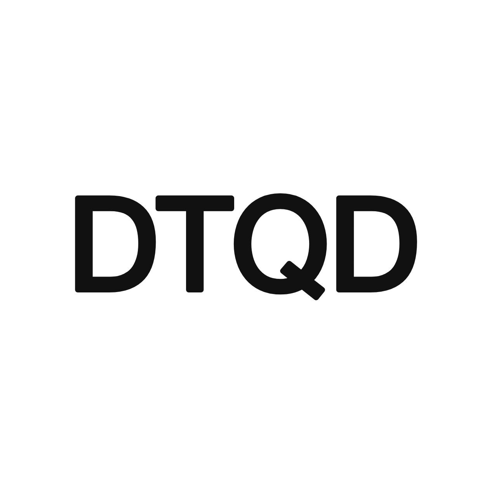

<div align="center">

<picture>
  
</picture>

</div>

---

<div align="center">

**An Agent Harness designed for DIICSUer**

</div>

---

> [!IMPORTANT]
> 首次打开须同意[使用条款](docs/terms.md)和[隐私条款](docs/privacy.md)。不同意部分内容：不配置对应服务、不提供其凭据，仍可用其余功能。全部不同意：退出并卸载。
>
> **DTQD 是第三方工具，与中南大学、邓迪大学（University of Dundee）、中南大学邓迪国际学院（DIICSU）及 Microsoft 无官方关系，访问校园系统未获其授权。** 这些系统的规则可能禁止第三方工具或自动化访问，你的账号可能因此受影响；开启连接前请读[使用条款第 2 节](docs/terms.md)。DTQD 不代表任何学校或学院立场，不承诺任何成绩或结果。
>
> 基于 [Chang-Yo/Dela](https://github.com/Chang-Yo/Dela)（GPL-3.0-or-later）修改，修改说明见 [NOTICE.md](NOTICE.md)。

DTQD 是面向 DIICSU 学生的 Agent 产品，内核基于 Pi。

凭据经系统钥匙串加密后存于本机，其余数据也存于本地；DTQD 没有存放用户数据的服务器。聊天内容发给你配置的大模型服务；重要事项 AI 提取默认关闭，开启后才自动发送新内容；反馈仅在你主动提交时发给 DTQD 团队。

## 功能概览

侧栏入口可在“设置 > 通用 > 导航入口”隐藏，试验功能可在“设置 > 通用 > 试验功能”开关。

### 校园信息服务

- **首页今天 / 本周**：汇总各处截止时间和重要事项
- **重要事项提取**：定期同步 Teams、Outlook、myDundee、学校通知和 QQ 接收文件的文件名；开启 AI 后由你配置的模型挑出重要事项（AI 默认关闭，来源可逐项关闭）
- **myDundee（Blackboard）**：查看课件、作业截止和公告，可批量下载或添加到本地项目
- **Dundee 邮箱**：一键连接 Outlook 网页版，也支持第三方 IMAP/SMTP 邮箱
- **Teams**：在独立窗口使用，@我 的消息和日历纳入提醒与课表
- **课表**：读取中南大学教务系统的个人课表，按教学周显示
- **校内通知问答**：在聊天中查询保研、考研、竞赛、就业和实习通知，回答附发布日期和原文链接
- **TODO 与截止提醒**：截止前 3 天、1 天、3 小时提醒，显示北京和英国时间，可导出 `.ics`
- **全局搜索**：跨项目、会话、邮件、课程资料、Teams 存档和设置

### Agent 功能

- **模型**：默认推荐 DeepSeek Flash（自备 API Key），可配置其他服务
- **扩展**：可导入第三方 skills、接入 MCP，兼容大部分 Pi Packages；扩展与 DTQD 同权限运行，安装前请确认来源可信
- **校园 skills**：读取你的课程、作业、邮件和课表
- **学习 skills**：写作反馈、给老师写邮件、术语表、成绩规划、备考、MC（Mitigating Circumstances）申请辅导；只辅导，不代写作业
- **联网**：`web_search` 默认关闭，需自备 API Key；`web_fetch` 免费，默认开启

### 工作台功能

- **Markdown 笔记**：即时渲染编辑，支持数学公式和 mermaid 流程图
- **文件编辑**：可打开编辑任意文本文件；1 MB 以上只读预览
- **内置终端**：在应用内打开终端

### 上游保留功能

以下是 Dela 面向上海交大的功能，DIICSU 暂无对应服务。代码保留，可在设置中开关：

- **课堂视频回看**：入口默认隐藏；中南 netclass 录播尚未接入
- **水源社区**：试验功能
- **remote project**：通过 SSH 把远端目录登记为项目

## 技术栈


## 下载安装

从 [GitHub Releases](https://github.com/ZhuchengX/dtqd/releases/latest) 下载。

| 平台                | 状态   |
| ------------------- | ------ |
| macOS（Apple 芯片） | 测试中 |
| Windows             | 适配中 |

macOS 安装包没有 Apple 签名；首次打开被拦截时，前往“系统设置 > 隐私与安全性”，选择“仍要打开”。

暂不支持应用内更新，新版本须重新下载安装。

## 本地开发

Node.js 版本见 [`.node-version`](.node-version)，pnpm 版本见 [`package.json`](package.json) 的 `packageManager`，兼容范围见 `engines`。

```sh
pnpm install
pnpm dev
```

| 命令                | 用途                                                  |
| ------------------- | ----------------------------------------------------- |
| `pnpm dev`          | 启动开发服务器和窗口，监听主进程/preload 变更         |
| `pnpm build`        | 类型检查与 main/preload/renderer 三入口生产构建       |
| `pnpm test`         | Vitest 单元测试                                       |
| `pnpm smoke`        | Electron 内 SQLite、React 渲染与 preload 隔离冒烟检查 |
| `pnpm package:dist` | 生成当前平台的安装包                                  |

环境搭建、冒烟测试与代码组织见[开发文档](docs/DEVELOPMENT.md)。

## 文档

| 文档                               | 内容                             | 读者           |
| ---------------------------------- | -------------------------------- | -------------- |
| [开发文档](docs/DEVELOPMENT.md)    | 架构、子系统约定、构建与发布流程 | 贡献者（先读） |
| [使用条款](docs/terms.md)          | 软件性质、责任划分与免责范围     | 使用者         |
| [隐私条款](docs/privacy.md)        | 数据存放位置与联网去向           | 使用者         |
| [更新日志](CHANGELOG.md)           | 按版本分节的变更记录             | 贡献者         |
| [贡献指南](CONTRIBUTING.md)        | 环境准备、提交规范与协作方式     | 贡献者         |
| [功能边界](docs/what-we-not-do.md) | 明确不做与需先讨论的功能         | 贡献者         |
| [安全策略](SECURITY.md)            | 漏洞报告渠道、支持范围与安全边界 | 使用者、贡献者 |
| [校园接口资料](docs/sjtu-apis.md)  | 上游 Canvas 与交大接口索引       | 贡献者         |
| [NOTICE](NOTICE.md)                | 上游项目、许可证与修改摘要       | 使用者、贡献者 |

## 贡献者

感谢上游 Dela 原作者 **[ChangYo](https://github.com/Chang-Yo)** 与所有贡献者。


## 许可

以 GNU General Public License v3.0（GPL-3.0-or-later）发布，全文见 [LICENSE](LICENSE)。

上游代码版权归 Dela 原作者与贡献者。Dela 的名称与 logo 等素材版权归原作者，不在 GPL 授权范围内；DTQD 已替换为自有名称与字标。

## 赞助鸣谢

感谢上游 Dela 的赞助者 [FRAMENEO](https://www.frameneo.com/) 等。支持 Dela 作者请前往 [Dela 仓库](https://github.com/Chang-Yo/Dela)。
